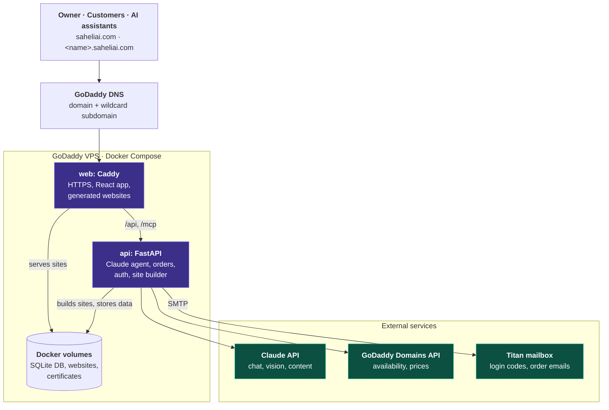

# Saheli AI

[](https://github.com/ananya-gta/saheli-ai/actions/workflows/ci.yml)

**Your talent deserves a business. Saheli makes it happen.**

Saheli ("friend" in Hindi) is a Hindi-first, voice-first AI business partner built with **Claude** and **GoDaddy**.
She helps a first-time woman entrepreneur in India go from *"main ghar se achaar bechti hoon"* to a live,
professional website that takes real orders — without ever hearing the words DNS, hosting or API.

🌐 **Live:** https://saheliai.com · 🎬 **Demo video:** [watch (76 s)](frontend/public/demo/saheli-demo.mp4) · 📊 **Presentation:** [docs/presentation.html](docs/presentation.html) · ✉️ **Questions:** [ananya.gta19@gmail.com](mailto:ananya.gta19@gmail.com)

[](frontend/public/demo/saheli-demo.mp4)

> **For judges: try it in 3 minutes (best on a phone)**
> 1. Open https://saheliai.com, tap **Saheli se baat karein** (or **Type your business idea**), and log in with any email (a one-time code arrives in your inbox, no password).
> 2. Tap the mic and say, in Hindi, Hinglish or English, what you sell, e.g. *"Main ghar se aam ka achaar banati hoon, Jaipur mein"*. Pick **English** in the header if you prefer.
> 3. Upload 1–2 product photos. Saheli names and describes them; you add prices.
> 4. Pick a name (live GoDaddy availability and prices), tap **Haan, banao**, and open your live site.
> 5. On the site: add to cart, place an order (UPI / cash), or tap **WhatsApp**. Then open the **Dashboard** to see the order and edit the site by voice.
>
> Nothing is bought without your approval. Test sites are free subdomains of saheliai.com.

---

## Contents
1. [The problem](#1-the-problem)
2. [The solution](#2-the-solution)
3. [How to use Saheli — step by step](#3-how-to-use-saheli--step-by-step)
4. [How Claude and GoDaddy are used](#4-how-claude-and-godaddy-are-used)
5. [Architecture](#5-architecture)
6. [Security, privacy and reliability](#6-security-privacy-and-reliability)
7. [What is real and what is not built yet](#7-what-is-real-and-what-is-not-built-yet)
8. [Run it locally](#8-run-it-locally)
9. [Deploy to production](#9-deploy-to-production)
10. [Tests and CI](#10-tests-and-ci)
11. [Project structure](#11-project-structure)
12. [Contact](#12-contact)

---

## 1. The problem

India has millions of women running small businesses from home — pickles, tiffin services, tailoring, mehendi,
tuition, baking. Most sell only to people who already know them, through WhatsApp and word of mouth.

Going online is hard for them, and not because they lack skill:

- **Every tool assumes English and tech vocabulary.** Website builders talk about domains, hosting, SSL, templates.
- **They are busy and on a phone.** Many would rather *speak* in Hindi than fill in a form.
- **A website is not the goal — orders are.** A pretty page without a way to order, pay and follow up doesn't
  change her income.
- **Trust.** She needs to know nothing will be bought or published without her saying yes.

## 2. The solution

Saheli is an **AI agent that does the work, in her language, and asks before acting.**

| She does | Saheli does |
|---|---|
| Talks in Hindi, Hinglish or English (voice or text) | Interviews her one simple question at a time and builds a structured business profile |
| Uploads photos of her products | Claude Vision names each product and writes descriptions; she only adds prices |
| Picks a name | Checks **real availability and prices on GoDaddy** and suggests alternatives |
| Taps *Haan, banao* ("Yes, build it") on an approval card | Builds a professional, mobile-first website in a design made for her trade, and publishes it at `https://<her-name>.saheliai.com` |
| Shares the link | Customers order from a cart → order number → **UPI payment** to her own UPI ID or cash on delivery → **WhatsApp** message to her; she gets an email |
| Opens her dashboard | Sees orders and enquiries, hears a spoken Hindi summary, edits the site by voice (*"aam ke achaar ka price 280 kar do"*), gets Instagram/WhatsApp/festival posts written for her, and a launch-readiness score |

Every website is also **agent-ready**: it exposes an MCP endpoint and an agent card, so a customer's own AI
assistant can browse the products and place an order.

## 3. How to use Saheli — step by step

> Works best in **Chrome** (desktop or Android) — voice input uses the browser's speech recognition.

### Step 1 — Log in (no password)
1. Open the app and tap **Bolkar shuru karein** (start by speaking) or **Type karke shuru karein** (start by typing).
2. Enter your email → you receive a **6-digit code** by email → enter it. That's your login.
   The code works for 10 minutes; you stay logged in for 30 days on that device.
3. First time only: tell Saheli your name.

### Step 2 — Tell Saheli about your business
- Speak or type naturally, e.g. *"Mere paas 20 tarah ke achaar hain, main Jaipur se poore India mein bhejna chahti hoon."*
- Saheli asks one short question at a time and offers quick-reply chips so you can just tap.
- A **profile card** appears with what she understood. Correct anything (*"nahi, daam 300 hai"*), then tap **Haan, sahi hai**.

### Step 3 — Add your products from photos
- Tap the 📷 camera button and choose 2–4 product photos.
- Saheli names each product and writes a short description. Add the prices and tap **Meri dukaan mein jodo**.

### Step 4 — Choose a name
- Ask for name ideas. **Domain cards** show names that are really available on GoDaddy, with the yearly price.
- Your website is always free at `<name>.saheliai.com`. Buying your own `.com` is optional and happens only on
  GoDaddy's checkout, with your approval.

### Step 5 — Approve and launch
- An **approval card** shows exactly what will happen and what it costs (₹0 today). Nothing is built until you tap **Haan, banao**.
- You see live progress, then a **success card** with a preview, a *verified live* check (Saheli opens your site
  herself and confirms it loads) and your **launch readiness score**.
- Under every reply, **Saheli ne N kaam kiye** expands into the real tool calls she made — nothing is hidden.

### Step 6 — Receive orders
- Share the link on WhatsApp. A customer adds items to the bag, enters name and phone, and taps **Place order**.
- They get an order number (e.g. **#1001**), a **Pay via UPI** button (amount and order number pre-filled; the money
  goes straight to your UPI ID) and **Send order on WhatsApp**.
- The order appears in your dashboard and your email. After you see the money in your UPI app, tap
  **Payment mil gayi**, and later **Deliver ho gaya**. Saheli never marks an order paid on her own.
- Customers can also send questions through the website's contact form; they arrive in your email and dashboard.

### Step 7 — Grow after launch (Dashboard)
- **Orders and enquiries** for each of your websites.
- **Summary suno** — a spoken Hindi summary of new enquiries and who to call back first.
- **Edit by voice** — *"Chocolate cake ka price 900 kar do"* → the live site updates in seconds.
- **Business assistant** — Instagram posts, WhatsApp announcements, festival offers, customer message templates.
- **Launch readiness** — a score made only from things that are really done, plus your next best step.

### Who can do what
| Anyone (customers) | Logged-in owner (only for her own websites) |
|---|---|
| Visit websites, order, pay by UPI, message on WhatsApp, send enquiries, use the MCP storefront | Chat with Saheli, upload photos, build websites, see orders/enquiries/summaries, edit her site, use the business assistant |

## 4. How Claude and GoDaddy are used

**Claude** (Anthropic Messages API, tool use):

| Where | How | Code |
|---|---|---|
| Interview agent | Multi-step tool-use loop with 5 tools: `save_business_profile`, `suggest_domains`, `check_domain`, `propose_website`, `create_growth_plan`. Bounded to 8 tool rounds and a 100 s budget per turn. | [`agent.py`](backend/app/agent.py) |
| Product catalogue | **Claude Vision** reads the owner's photos → structured items (name, Hindi name, description, category) | [`catalog.py`](backend/app/catalog.py) |
| Website content | A forced tool call returns validated, structured content and picks a design + palette. **Claude never writes HTML** — Jinja2 templates with auto-escaping render it. | [`sitegen.py`](backend/app/sitegen.py) |
| Edit by voice | A forced tool call returns only the changed fields; deterministic code validates them before they go live | [`editor.py`](backend/app/editor.py) |
| Summaries and marketing | Fast model for enquiry summaries (falls back to the main model); business assistant for posts and messages | [`editor.py`](backend/app/editor.py), [`launch.py`](backend/app/launch.py) |

**GoDaddy:**

| Where | How |
|---|---|
| Domain discovery | GoDaddy **Domains v3 API** — natural-language suggestions and exact availability with live prices, with retries and a circuit breaker ([`godaddy.py`](backend/app/godaddy.py)) |
| Hosting | GoDaddy **VPS** running Docker; Caddy issues HTTPS certificates on demand for every business subdomain |
| Domain and DNS | Domain bought on GoDaddy; DNS records managed with the **`gddy` CLI** ([`scripts/setup-dns.sh`](scripts/setup-dns.sh)) |
| Email | **Titan Business Email** mailbox on the domain; login codes, order and enquiry notifications go through its SMTP server. The password lives only in the server's `.env`. |

## 5. Architecture



<details>
<summary>Module map (inside the containers)</summary>

```
                 ┌──────────────────────── GoDaddy VPS (Docker Compose) ─────────────────────────┐
 Owner (phone) ──┤  Caddy  (HTTPS, on-demand certificates, security headers)                    │
 Customer ───────┤    ├─ saheliai.com            → React app (Vite build)                        │
 AI assistant ───┤    ├─ saheliai.com/api, /mcp  → FastAPI                                       │
                 │    └─ <slug>.saheliai.com     → generated website (static, read-only volume)  │
                 │                                                                               │
                 │  FastAPI (non-root container)                                                 │
                 │    main.py ── routes, auth checks, rate limits, request IDs, error contract    │
                 │      ├─ agent.py ──── Claude tool-use loop ──┬─ godaddy.py → GoDaddy API      │
                 │      │                                        └─ approval card (no spending)  │
                 │      ├─ catalog.py ── Claude Vision                                           │
                 │      ├─ sitegen.py ── Claude content → design.py + Jinja2 templates           │
                 │      │                └─ images.py (owner photos > Pexels > Openverse)        │
                 │      ├─ editor.py / launch.py ── edits, verification, readiness, assistant    │
                 │      ├─ orders.py / enquiries.py / storefront.py (MCP) ── public endpoints    │
                 │      └─ auth.py ── email-code login, sessions, ownership                      │
                 │    resilience.py ── retries, timeouts, circuit breakers, error classification │
                 │    sitestore.py ─── atomic, locked site data · staged builds                  │
                 │    db.py ────────── SQLite (WAL, versioned migrations)                        │
                 │  Volumes: data (DB, private site data, uploads — API only) · sites (public)   │
                 └──────────────────────────────────────┬────────────────────────────────────────┘
                                                        └─ SMTP → Titan mailbox on the domain
```

</details>
Design principles:
- **Claude proposes, code decides.** AI output is structured (tool calls with JSON schemas), validated, and
  rendered by deterministic code. The agent never spends money, and nothing is published without the owner's tap.
- **Every external call can fail.** Timeouts, bounded retries with jitter, circuit breakers, and graceful
  degradation that keeps work already done.
- **Private by default.** Customer data and owner details are never inside the folder the web server publishes.

## 6. Security, privacy and reliability

**Authentication and access**
- Passwordless email-code login: codes and session tokens are stored only as HMAC-SHA256 hashes; 5 attempts per
  code, re-send after 60 s, max 10 codes per email per day, per-IP limits.
- Sessions in `HttpOnly`, `SameSite=Lax`, `Secure` cookies; logout revokes the session on the server.
- Every owner API checks ownership and returns *404* for anyone else (no IDOR, no information leak). Ownership is
  insert-only — a website can never be transferred to another account.

**Data protection**
- Owner profile, UPI ID and customer enquiries live in the database and a private volume the web server cannot see.
- Notification emails go only to the owner's verified login email, so the platform mailbox can't be used as a relay.
- Secrets only in `.env` (git-ignored, `chmod 600` on the server). `ENV=production` is explicit, and the API
  **refuses to start** with unsafe settings (default secret, no domain, no SMTP).
- Uploaded photos are decoded and re-encoded, size-limited, and owned by one user.

**AI safety**
- The profile the browser sends back is untrusted: it is reduced to known, typed, size-limited fields and given to
  Claude as data inside `<profile>` tags, with an instruction to ignore embedded instructions.
- Tool permission boundary: no purchasing tool exists; `propose_website` only shows an approval card.
- AI edits are validated before publishing: prices must be positive and bounded, palettes must exist, photos must
  be the owner's own.

**Reliability**
- Orders are **idempotent** (`Idempotency-Key` from the website and the MCP tool) — a double tap or a retried AI call
  never creates a duplicate. Order numbers are assigned inside a `BEGIN IMMEDIATE` transaction.
- Site data is written atomically under a per-site lock; new sites are built in a staging folder and published
  with one rename, so a failed build leaves nothing behind.
- Claude: SDK retries, 90 s timeout per call, 100 s budget per turn; if Claude fails after tools ran, completed
  work is kept. GoDaddy and photo providers: retries with backoff and circuit breakers.
- One error shape for every failure: `{detail, code, retryable, service, request_id}` — internals stay in the logs.
- Every request has an `X-Request-ID` (response header, error body, log line). `/api/health` reports database
  status and circuit breaker states. Containers have health checks, restart policies and log rotation.

## 7. What is real and what is not built yet

| Capability | Status |
|---|---|
| Claude agent with tool use, Claude Vision catalogue | ✅ Real |
| GoDaddy domain suggestions, availability and price | ✅ Real (Domains v3 API) |
| Website generation (5 trade-specific designs), photo pipeline | ✅ Real |
| Hosting on `<name>.saheliai.com` with HTTPS | ✅ Real (GoDaddy VPS + Caddy) |
| Customer orders, server-side pricing, idempotency | ✅ Real |
| Email notifications (login codes, orders, enquiries) | ✅ Real (Titan SMTP) |
| MCP storefront for AI assistants | ✅ Real |
| UPI | ⚠️ UPI intent link to the owner's own UPI ID — **not a payment gateway**; the owner confirms payment |
| Buying a domain through the API | ❌ Not built — bought on GoDaddy checkout |
| Connecting a purchased domain to a Saheli site | ❌ Not built yet |
| Languages beyond Hindi / Hinglish / English | ❌ Not yet |

The demo video is a product walkthrough recorded with **sample data** (labelled in the video).

### Roadmap

**Next (closing the gaps above)**
- **Her own domain, end to end, on the GoDaddy Developer Platform:** Saheli already uses its Domains v3 API (search, availability, prices) with a personal access token. Next we add its registration and DNS APIs, so after her *"haan"* the domain is bought, pointed to her site and renewed on time, with reminders in Hindi. Its hosting and email APIs can later give each business its own mailbox.
- **Working alongside GoDaddy Airo:** Airo serves owners who are comfortable with GoDaddy's builder. Saheli brings women who aren't there yet into the GoDaddy ecosystem, and when Airo offers a partner API, Saheli can hand a ready business profile over to it.
- **Real payments:** a UPI payment gateway so orders are marked paid automatically.
- **More Indian languages:** Devanagari Hindi, then Marathi, Tamil, Bengali and others, plus a warmer neural Hindi voice.

**Growth for her business**
- **WhatsApp Business:** order alerts and replies to customers on the app she already uses every day.
- **Google Business Profile and Maps** listing created from the same profile.
- **Monthly insights by voice:** *"Is mahine 32 orders aaye, aam ka achaar sabse zyada bika."*
- **Credit and schemes:** use her order history to guide her to Mudra loans and government schemes for women entrepreneurs.

**Scale**
- **Data:** move from SQLite (WAL) to managed PostgreSQL. All access goes through one module (`db.py`), so this is a contained change.
- **Reach:** partner with self-help groups and NGOs to onboard women who don't have email yet (phone/OTP login).

## 8. Run it locally

**Requirements:** Python 3.12+, Node.js 20+, a Claude API key, a GoDaddy Personal Access Token
(`domains.domain:read`). SMTP and a Pexels key are optional locally.

```bash
git clone https://github.com/ananya-gta/saheli-ai.git && cd saheli-ai
cp .env.example .env                       # fill ANTHROPIC_API_KEY, GODADDY_PAT, SECRET_KEY
python3 -c "import secrets;print(secrets.token_urlsafe(48))"   # → SECRET_KEY

# backend  (terminal 1)
cd backend
python3 -m venv .venv && source .venv/bin/activate
pip install -r requirements-dev.txt
python -m uvicorn app.main:app --reload --port 8000      # http://localhost:8000/api/health → "ok": true

# frontend (terminal 2)
cd frontend && npm ci && npm run dev                       # http://localhost:5173
```

- **Login locally:** without SMTP, the 6-digit code is printed in the backend terminal and shown on the login
  screen (development only — never in production).
- **Demo websites:** built automatically in the background on first start (needs internet). Or run
  `python -m app.demo_sites you@example.com` to build them and show them in your dashboard.
- **Admin:** `python -m app.manage users` lists users and their websites.
- **AI-agent test:**
  ```bash
  curl -s localhost:8000/mcp/demo-bakery -H 'Content-Type: application/json' \
    -d '{"jsonrpc":"2.0","id":1,"method":"tools/call","params":{"name":"list_products","arguments":{}}}'
  ```

| Problem | Fix |
|---|---|
| Voice doesn't work | Use Chrome; allow the microphone (🔒 in the address bar) |
| Websites have no photos | The backend needs internet access; add a free `PEXELS_API_KEY` for better photos |
| `model not found` | Set `CLAUDE_MODEL` / `CLAUDE_FAST_MODEL` to models available in your Claude Console |
| Titan login rejected | Use `SMTP_HOST=smtpout.secureserver.net`, port 465, full email address as the username |

## 9. Deploy to production

Full step-by-step guide: **[DEPLOY.md](DEPLOY.md)** — GoDaddy VPS → Docker → DNS with the `gddy` CLI → HTTPS →
Titan mailbox → `scripts/deploy.sh`. In short:

```bash
# on the VPS, in the cloned repo, with .env filled in (ENV=production, DOMAIN=..., SECRET_KEY, SMTP_*)
chmod 600 .env
./scripts/deploy.sh          # builds, starts, waits for health, checks https://<DOMAIN>/api/health
```

## 10. Tests and CI

```bash
cd backend && python -m pytest -q        # 53 tests
cd frontend && npm run typecheck && npm run build
```

The tests cover: retries and backoff, circuit breaker states, error classification, GoDaddy outages, timeouts and
4xx responses, the agent loop under Claude and tool failures, order validation, the API error contract, login
brute-force limits, cross-owner access (IDOR), ownership transfer, mail-relay protection, untrusted profiles, unsafe
production configuration, idempotent and concurrent orders, lost-update protection, failed-build rollback and
validation of AI edits. GitHub Actions runs the backend tests, the frontend typecheck and build, and the Docker
image build on every push and pull request.

## 11. Project structure

```
saheli-ai/
├── backend/app/
│   ├── main.py          API routes, middleware (request IDs, rate limits), error contract
│   ├── agent.py         Claude tool-use agent: interview, domains, approval card, growth plan
│   ├── catalog.py       photo upload + Claude Vision catalogue
│   ├── sitegen.py       Claude content → design archetype → Jinja2 website
│   ├── design.py        5 design identities (fonts, palettes, vocabulary, icons)
│   ├── images.py        photo pipeline: owner photos > Pexels > Openverse; crop, resize, self-host
│   ├── editor.py        edit by voice + enquiry summaries
│   ├── launch.py        live verification, readiness score, business assistant
│   ├── orders.py        orders: server-side pricing, idempotency, owner payment confirmation
│   ├── enquiries.py     enquiries: database + email
│   ├── storefront.py    MCP server + agent-card.json + llms.txt per site
│   ├── auth.py          email-code login, sessions, ownership
│   ├── sitestore.py     site data: atomic writes, per-site locks, staged builds
│   ├── db.py            SQLite (WAL) + versioned migrations
│   ├── godaddy.py       GoDaddy Domains v3 client (retries + circuit breaker)
│   ├── resilience.py    error classification, retry, circuit breaker, failure drills
│   ├── claude.py        shared Claude client (timeouts, retries)
│   ├── mailer.py        SMTP (Titan)
│   ├── config.py        settings + production safety checks
│   └── templates/       website layouts: bakery, home food, boutique, beauty, education
├── backend/tests/       pytest suite
├── frontend/            React + TypeScript + Tailwind (Vite) · Caddyfile · Dockerfile
├── scripts/             deploy.sh, setup-dns.sh (gddy CLI)
├── docs/presentation.html   architecture and product presentation (open in a browser)
├── docker-compose.yml   production stack
└── .env.example         every setting, documented
```

## 12. Contact

Built by **Ananya Gupta** for the GoDaddy Inclusive Innovation Hackathon 2026.

For any questions about the project, setup or demo, email **[ananya.gta19@gmail.com](mailto:ananya.gta19@gmail.com)**.

© 2026 Ananya Gupta. All rights reserved — see [LICENSE](LICENSE).
